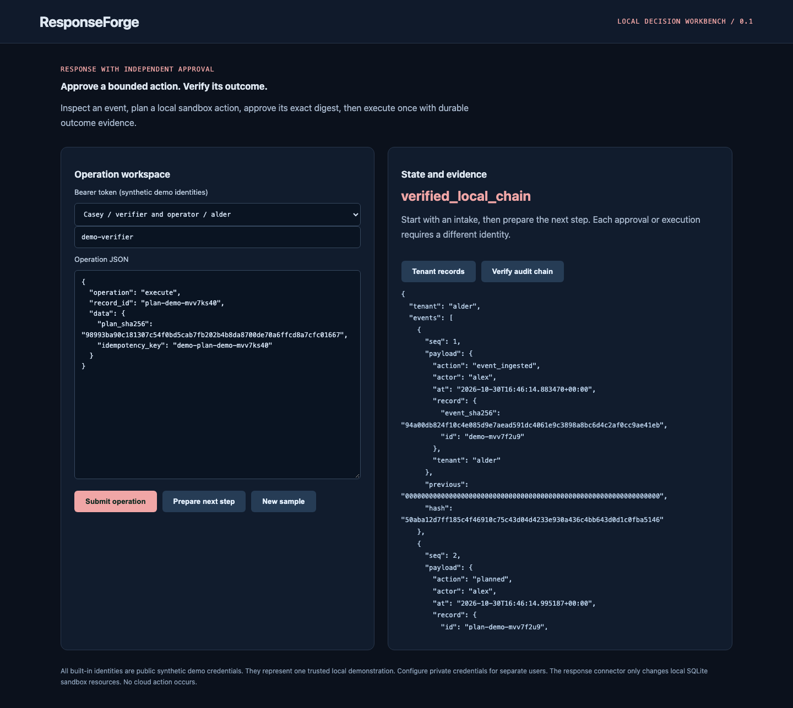

# ResponseForge

[](https://github.com/jayekwere/responseforge/actions/workflows/verify.yml)
[](LICENSE)

**Incident response decisions with independent approval and verified outcomes.**

A Python FastAPI and SQLite SOAR reference implementation with a TypeScript workbench. It ingests security events, constructs bounded response plans, requires independent approval, executes a fixed local sandbox action exactly once per operation key, and records the observed outcome with a durable audit chain.



## Run locally

Requires Node 24.13+ or Node 26, Python 3.14, and a trusted workstation. The initial setup downloads locked dependencies. Afterwards the core synthetic CLI and UI demos work offline. No cloud account or paid service is required.

```sh
git clone https://github.com/jayekwere/responseforge.git
cd responseforge
npm ci --ignore-scripts
python3 -m venv .venv
.venv/bin/python -m pip install --require-hashes -r requirements-dev.lock
npm run build
.venv/bin/python -m app.cli demo
.venv/bin/python -m app.cli serve --demo
```

Open [http://127.0.0.1:8080](http://127.0.0.1:8080). For a container demo, run `docker compose up --build`. Compose publishes only to loopback, uses UID 10001, drops capabilities, denies privilege escalation and makes the root filesystem read-only. A named volume preserves SQLite state; `docker compose down -v` removes demo state. The default network posture is local-only. Do not expose a demo listener as a production service.

## What it enforces

- Two fixed policies map malware detection to host isolation and credential anomaly to identity disabling. Resource IDs must start with `sim:`. No arbitrary command, destination URL, Python expression or cloud API is accepted.
- A plan binds tenant, source event digest, resource version, policy digest, requester, outcome and a 30-minute expiry.
- Requester, approver and operator must be different subjects even when a subject has multiple roles. Execution rechecks policy, freshness, target state/version, approval and exact digest.
- An immediate SQLite transaction covers sandbox mutation, readback verification, plan status, audit evidence and idempotency response. Concurrent retries and restart retries return the same result without another mutation.
- Reusing a key with a different digest or actor rejects. Failed outcome verification rolls the transaction back and never records success.

HTTP request buffering is bounded by bytes and uses linear replay across fragments. Incomplete transport bodies cannot become completed operations. See [the audit and hardening record](docs/security-audit.json) for exact scope, regressions and limitations.

## Inputs, integrations and evidence

The local sandbox connector is an actual, persistent SQLite integration that changes tenant-scoped synthetic resource state. It is always labeled `local-simulation`. It does not disable a real identity, isolate a real endpoint, send messages or connect to AWS/Azure/GCP. The offline demo verifies readback of `isolated` and retries the same execution key. Tests additionally exercise `disabled`, concurrent retries, stale approvals, changed policy/target, failed readback and cross-tenant attempts.

Use the browser to ingest an event as Alex, plan a response, try the denied self-approval, approve as Blair, then execute as Casey. Switch to the other tenant to verify empty records. The evidence view verifies the stored chain. The event digest supplied by an authorized analyst is an assertion, not an authenticated EDR artifact.

Generated machine output is committed in [samples/output.json](samples/output.json). The [architecture](docs/architecture.md), [threat model](docs/threatmodel.md), [verification record](docs/verification.md), and [distinct scope](docs/portfolio-scope.md) explain the implementation and its boundaries. Strict runtime models are authoritative; published [schemas](schemas) document the contracts. External Terraform and SARIF metadata can carry provider extensions; security-relevant fields receive explicit validation.

## Verify

```sh
# Activate the installed Python environment first.
. .venv/bin/activate
npm run verify
python -m ruff check app tests
python -m mypy app
python -m pytest
npx playwright install chromium
npm run test:browser
docker build -t responseforge:local .
node scripts/container-smoke.mjs responseforge:local
```

CI runs lint, strict TypeScript checks, unit/adversarial tests, measured coverage, builds, the local demo, browser interactions, dependency audit and a hardened container smoke check. Python CI additionally runs Ruff, strict mypy and pytest with an 80% branch-inclusive coverage floor. Every Action uses a verified full commit SHA, checkout credentials are disabled, and the verification workflow has only contents read permission. Browser installation and container builds need network during setup. Artifact retention is 14 days. Repository maintainers control policy and workflow changes.

## Limits and trust

The transactional local connector remains the default demo. Separate real AWS, Azure and GCP identity response connectors now implement configured target pinning, independent approvals, durable dispatch, ambiguous-outcome reconciliation and native readback. AWS live acceptance verified a dedicated test key through disable, native readback, restore and native readback, then deleted the test key and identity. See [the live receipt](docs/aws-live-verification.json). Approvals used three synthetic subjects controlled by one operator; this is not evidence of independent human approval. Azure and GCP remain implemented and contract tested with live account acceptance unverified. See [authorized cloud response](docs/live-connectors.md) for setup, exact operations and limits. EDR isolation and ticketing connectors remain unimplemented. External effects do not inherit SQLite atomicity.

Demo identities are public synthetic credentials. The configured identity map must bind separate subjects to separate people to establish actual separation of duties. There is no SSO, credential rotation service, distributed queue, scheduler, rate limiting or production high-availability claim. Failure transactions roll back; success evidence is committed with the action. The local audit chain does not withstand an administrator rewriting or truncating all records. Export and independently retain checkpoints when needed.

Configured serve mode requires `IDENTITY_FILE` pointing to a private JSON map from random bearer tokens of at least 32 characters to `{tenant, subject, roles}`. Set `STATE_PATH` for persistent private state. The CLI validates identity file permissions. Direct factory callers own equivalent credential provisioning. Roles are analyst, approver, verifier, operator and viewer; each operation checks its required role. There are no default production credentials.

See [SECURITY.md](SECURITY.md) and [CONTRIBUTING.md](CONTRIBUTING.md). MIT covers this repository's original code; dependencies retain their respective licenses.

---

**AI assistance:** AI tools helped with code or documentation.
