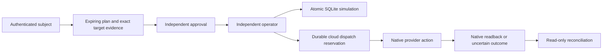

# Architecture

ResponseForge has a transactional synthetic workflow and a separate live cloud dispatch workflow. Both use identity-derived tenant and roles, fixed operations, independent subjects and durable evidence. The browser and default Docker Compose deployment demonstrate only the synthetic workflow.

| Component | Responsibility |
| --- | --- |
| `app/api.py` | Authenticated operations, strict payloads, body/Host/Origin controls and separate cloud endpoint |
| `app/common.py` | Trusted identities, tenant-scoped SQLite storage and local evidence chain |
| `app/playbooks.py` | Fixed synthetic playbooks and atomic simulation mutation/readback/idempotency |
| `app/cloud.py` | Native-state plans, independent approvals, durable reservations, locks and reconciliation |
| `app/connectors.py` | Configured AWS, Azure and GCP targets, native identity pinning and fixed provider operations |
| `app/cli.py` | Explicit demo or configured startup; private identity and cloud-registry loading |

The local path accepts only `sim:` resources. Its mutation, readback, audit and idempotency response share one SQLite transaction. That atomicity applies to the simulation. The live path accepts only a configured tenant alias, never caller-selected native identifiers, profiles or URLs.

Live plans bind registry, native before-state, event evidence, policy, requester and expiry. Separate subjects approve and operate. Before a provider write, the service commits a reservation and physical-target lock, verifies native preconditions and expiry, and records write_started. No database transaction spans the provider request. A timeout or failed readback retains an uncertain result and lock; after a cooldown, reconciliation performs reads only. An approved restore is limited to this service's eligible verified disable. These controls do not establish distributed exactly-once execution or revocation of issued sessions.

AWS updates a pinned IAM access-key status. Azure updates a pinned Application service principal's accountEnabled property. GCP disables or enables a pinned service-account uniqueId. Native ownership markers supplement exact provider IAM restrictions. Provider CLIs, credential stores, the service host and private configuration are trusted. EDR isolation, arbitrary command playbooks and ticketing response are not implemented.

`--demo` rejects a live cloud registry. Configured host startup requires private `IDENTITY_FILE` and optional `CLOUD_TARGET_FILE`; `STATE_PATH` selects the durable database. Default Compose supplies no live credential tools or account mounts. The database is mode 0600, while parent-directory and companion-file privacy remain host responsibilities.

Cloud adapters are implemented and contract tested. Historical dedicated AWS disable/restore acceptance is recorded in aws-live-verification.json; Azure/GCP live acceptance remains unverified. Event hashes remain analyst assertions. Public demo subjects do not prove independent human control. The local chain detects retained-sequence changes, not a trusted administrator rewriting all state. See [live connector setup](live-connectors.md) and the [threat model](threatmodel.md) for exact effective resources and limitations.

The request-body gate accumulates bounded bytes and replays a single message, avoiding per-frame retention and quadratic list replay. An incomplete-body disconnect remains a disconnect and cannot become an authenticated operation. The inclusive 1 MiB byte limit and non-HTTP passthrough remain unchanged. See [the hardening record](security-audit.json).
