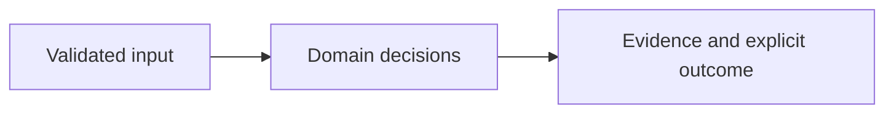

# Architecture

Bearer identity --> event --> fixed policy plan --> independent approval --> independent operator --> transactional local sandbox mutation --> readback --> audit and idempotency result

| Component/source | Responsibility |
| --- | --- |
| `app/api.py:65` | Authenticated operation API and bounded HTTP middleware |
| `app/common.py:176` | Trusted bearer identity, tenant and role lookup |
| `app/playbooks.py:56` | Expiring plans, independent subjects and execution checks |
| `app/playbooks.py:43` | SQLite-only response connector |
| `app/common.py:102` | Transactional evidence hash chain |

## Effective resources

| Deployment or consumer | Configuration and location | Recipients or authority | Enforcing control |
| --- | --- | --- | --- |
| Configured credentials | IDENTITY_FILE private token map | Server memory and trusted operator | CLI checks credential length/privacy; direct factory users own equivalent checks |
| Configured state | STATE_PATH or artifacts/state.db | Tenant-scoped API actors and server | SQLite WAL, composite tenant keys, immediate transactions, database mode 0600; private directory required |
| Execution target | objects[(identity.tenant, plan.resource, resource)] with sim: resource IDs | Local SQLite sandbox only | Two fixed policies/outcomes; no shell, arbitrary destinations or external cloud writes |
| Offline demo | Temporary demo.db, fixed clock and public demo identities | Synthetic actors | Temporary local state only; duplicate execution verifies identical committed outcome |

## Trust and decisions

Authenticated identity supplies tenant and role. An analyst can submit supported events and create only synthetic sandbox resources. A plan binds event/resource/policy digests, expected resource version and expiry. Approval rejects requester self-approval. Execution requires an operator distinct from requester and approver and rechecks all approved preconditions. Mutation, provider readback, success audit and idempotency response are in one immediate SQLite transaction. This atomicity applies only to this local connector.

Core domain decisions are separated from HTTP, CLI and external integration adapters. Runtime models reject unsupported contracts instead of interpreting arbitrary instructions. The UI renders supplied strings with textContent. Container startup uses UID 10001 and loopback publication through Compose. Setup downloads dependencies and optional tools once; core synthetic evaluation does not require a network.

## Unresolved integration scope

No external EDR, cloud, IAM or ticketing response is implemented. Event evidence hashes are analyst assertions. Public demo identities provide no real human separation. Local chain integrity does not prevent an administrator rewriting or truncating all state; no production HA or throughput claim.

See the README for exact setup, sample outputs, decision semantics and limits. The threat model distinguishes hypotheses from source-established controls.
